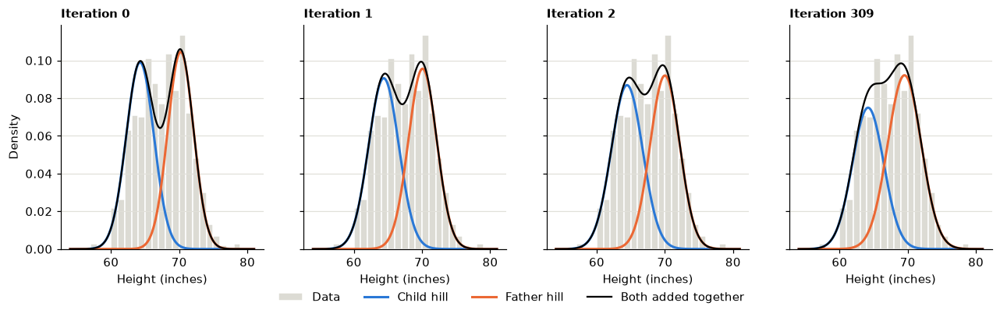
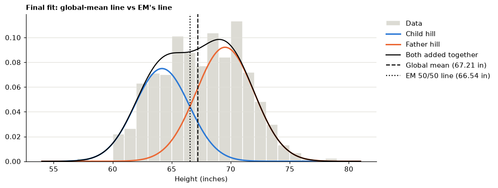
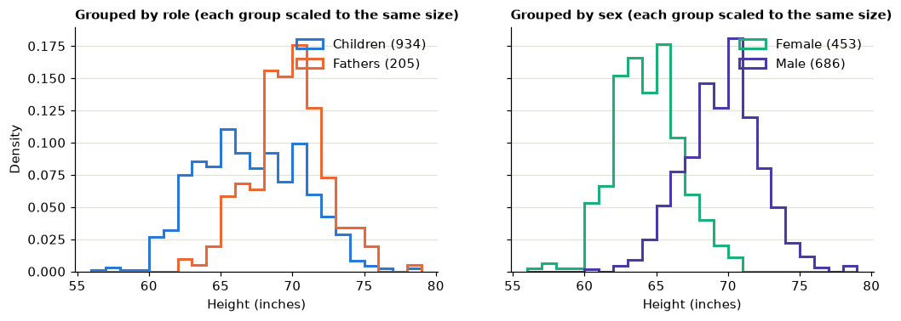
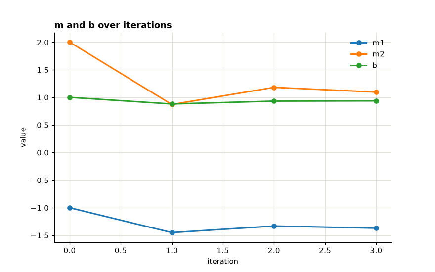
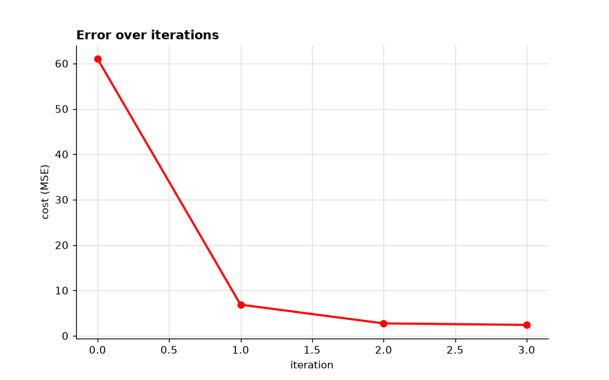

# Formative 3 — Group 16

This project brings together our work on probability distributions, Bayes' theorem and gradient descent. Parts 1, 2 and 4 are in one Jupyter notebook. Our handwritten work for Part 3 is in a separate PDF.

| Member | GitHub | Main work |
|---|---|---|
| Belyse Intwaza | [@intwaza](https://github.com/intwaza) | Part 1 and Part 3, iteration 2 |
| Erin Leyian | [@erin-leyian](https://github.com/erin-leyian) | Part 2 and Part 3, iteration 1 |
| Iza Prince Boaz | [@boaziza](https://github.com/boaziza) | Part 4 and Part 3, iteration 3 |

## Part 1: EM algorithm on height data

We used Galton's family data and combined **934 adult children's heights with 205 fathers' heights**. We hid the labels during fitting and used EM to estimate two Gaussian groups. Each group is described by its mean (μ), variance (σ²) and share (π).

We initialized the model by splitting the data at its global mean. EM then repeated two steps: the **E-step** calculates each height's probability of belonging to each group, and the **M-step** uses those probabilities as weights to update the groups' means, variances and shares. We stopped when the log-likelihood improvement became smaller than 10⁻⁶.

### Tracking the first iterations

The assignment's table template labels the second group "Pros" and asks for "Basketball Player" probabilities. That wording comes from an earlier version of the task. We modelled **fathers and children**, so our groups are labelled **Child** (the shorter group) and **Father** (the taller group) throughout.

| Iteration | μ1 (Child) | μ2 (Father) | σ²1 | σ²2 | π1 | π2 | Log-likelihood |
|---|---:|---:|---:|---:|---:|---:|---:|
| 0 (initialization) | 64.2598 | 70.2147 | 4.1428 | 3.5711 | 0.5048 | 0.4952 | −3071.1165 |
| 1 | 64.3784 | 70.0758 | 4.9168 | 4.2979 | 0.5033 | 0.4967 | −3053.5777 |
| 2 | 64.4368 | 69.9988 | 5.3058 | 4.6724 | 0.5017 | 0.4983 | −3049.7088 |
| 309 (converged) | 64.1772 | 69.5186 | 5.3024 | 6.0410 | 0.4325 | 0.5675 | −3046.9895 |



### Should we split at the global mean?

**No.** A hard cut puts each height completely into one group, even when it is near the overlap. EM instead gives a probability for each group. In our data, the global mean is **67.21 inches**, while the model's 50/50 point is **66.54 inches**. The initial split also gives smaller variances because it cuts off the tails. The log-likelihood improves from **−3071 to −3047** as EM updates the estimates.



### What the model's groups represent

We compared the fitted groups with the real labels after training. In this run, the groups matched **female and male heights** more closely than they matched **children and fathers**. The model classified 84.7% correctly by sex, but only 56.5% by family role; always guessing “child” would be correct 82% of the time. Adult sons are about as tall as their fathers, so height alone does not reliably distinguish them.

The live demo in the notebook prints P(Child | height) and P(Father | height) for a height entered in inches or centimetres. These are probabilities for the fitted groups, so they should not be treated as a reliable test of someone's actual family role.



## Part 2: Bayes' theorem on IMDb reviews

We used the IMDb dataset of 50,000 reviews, with 25,000 positive and 25,000 negative reviews. Our chosen probability is **P(Negative | keyword)**:

`P(Negative | keyword) = P(keyword | Negative) × P(Negative) / P(keyword)`

The prior is the share of negative reviews, the likelihood is the share of negative reviews containing the word, and the marginal is the share of all reviews containing it. We use basic Python's `csv` and `re` modules; each review counts once per keyword, even if the word appears more than once.

| Keyword | Expected signal | P(Negative | keyword) |
|---|---|---:|
| excellent | Positive | 0.1926 |
| wonderful | Positive | 0.1879 |
| perfect | Positive | 0.2343 |
| great | Positive | 0.3259 |
| worst | Negative | 0.9073 |
| awful | Negative | 0.9018 |
| terrible | Negative | 0.8585 |
| waste | Negative | 0.9313 |

Words like “worst” and “waste” are strong signs of a negative review in this dataset. “Great” is less reliable: the code counts the word but does not understand context such as “not great” or sarcasm. The notebook prints the prior, likelihood, marginal and posterior for every keyword.

## Part 3: Gradient descent by hand

Each group member completed one update in the handwritten calculations: [Part3 Manual Calculation.pdf](Part3%20Manual%20Calculation.pdf).

We used `ŷ = Xm + b`, with **m = [−1, 2]**, **b = 1**, learning rate **α = 0.01**, data points **X = [(1, 3), (4, 10)]**, and targets **y = [5, 6]**. The assignment did not specify a learning rate, so our group chose 0.01.

For mean squared error `J = (1/n) Σ(ŷ − y)²`, the gradients are:

`∂J/∂m = (2/n) Xᵀ(ŷ − y)`  
`∂J/∂b = (2/n) Σ(ŷ − y)`

| Update | Member | m after update | b after update | Cost after update |
|---|---|---|---:|---:|
| Start | — | [−1, 2] | 1 | 61 |
| 1 | Erin | [−1.45, 0.87] | 0.88 | 6.845 |
| 2 | Belyse | [−1.3316, 1.1808] | 0.9318 | 2.7238 |
| 3 | Boaz | [−1.369562, 1.095182] | 0.93624 | 2.3904 |

### The trend in m and b

**m2 changed the most.** It dropped from 2 to 0.87 in the first update, because x2 has the largest values (3 and 10), which gave it the largest gradient (∂J/∂m2 = 113). It then moved back up to 1.18 and settled at 1.10. **m1** went from −1 to −1.45, then to −1.33 and −1.37. **b** dipped from 1 to 0.88, then rose to 0.93 and 0.94.

The values zigzag because the first update overshot. The predictions went from too high ([6, 17]) to too low ([2.04, 3.78]), so the gradients flipped sign and the next updates moved m and b back the other way. Each correction is smaller than the one before, so the values are settling.

**Are they moving in a direction that reduces the error? Yes.** The cost falls after every update: **61 → 6.845 → 2.724 → 2.390**. Each update moves m and b opposite to the gradient, which is the downhill direction of the error. The drops get smaller (54.2, then 4.1, then 0.3) as we approach the minimum, where the slope is flatter.

## Part 4: Gradient descent in code

Section 4 of the combined notebook carries out the same updates in Python. It shows the predictions, errors, gradients and parameter updates at each step. We also use SciPy's numerical derivative to compare with the gradients from the formulas, and Matplotlib to plot the parameter and cost changes.

After three updates, the model gives predictions of about **[2.85, 6.41]**. After 2,000 updates, the cost is close to zero and the predictions are approximately **[5, 6]**.

| Parameter changes | Cost changes |
|---|---|
|  |  |

## Run the notebook

Use Python 3.10 or newer. From the project folder, install the packages and start Jupyter:

```bash
python3 -m venv .venv
source .venv/bin/activate
python -m pip install -r requirements.txt
jupyter notebook formative3_group16.ipynb
```


## Project files

- [Combined notebook](formative3_group16.ipynb) 
- [Part 3 calculations](Part3%20Manual%20Calculation.pdf).
- `data/GaltonFamilies.csv` 
- `figures/` 
- `requirements.txt` 

See the [contribution sheet](BSE%20Group%20Assignments%20_%20Task%20Sheet_Machine_Learning_Formative_3_Group_16.pdf) and [GitHub commit history](https://github.com/intwaza/formative-3-group-16/commits/main) for contribution details.
