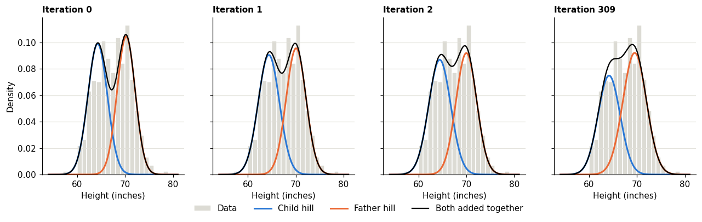
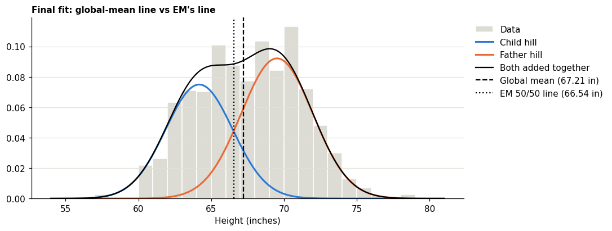
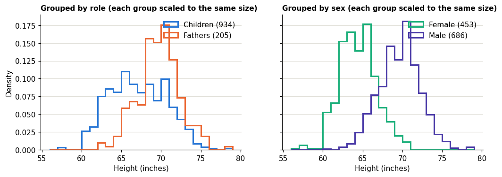
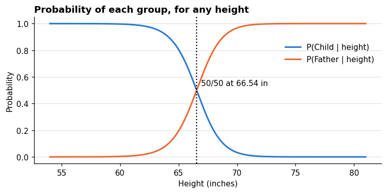

# Part 1: EM algorithm on Galton's family heights

We combine the heights of **934 adult children and 205 fathers**, then fit a two-group Gaussian mixture without using the family labels. The EM steps are implemented in the notebook, with an explanation beside each one.

## How to run

From the project folder, the first time only:

```bash
python3 -m venv .venv
source .venv/bin/activate
pip install -r requirements.txt
python -m ipykernel install --user
```

Then, every time:

```bash
source .venv/bin/activate
jupyter notebook part1_em/part1_em.ipynb
```

In the browser tab that opens, choose **Run → Run All Cells**.

If the notebook says the kernel failed to start, run `python -m ipykernel install --user` again with the environment active. It points Jupyter at this project's Python.

| File | Contents |
|---|---|
| `part1_em.ipynb` | Everything: loading the data, the EM algorithm (`bell_curve`, `e_step`, `m_step`, `log_likelihood`, `run_em`), the tracking table, the global-mean comparison, the check against the hidden labels, and the live demo |
| `plots.py` | The chart functions (charts are saved to `figures/`) |
| `data/GaltonFamilies.csv` | The dataset |

## Tracking table (fathers + children)

Iteration 0 is the naive "split at the global mean" answer, which we use as EM's starting point.

| Iteration | μ1 (Child) | μ2 (Father) | σ²1 | σ²2 | π1 | π2 | Log-likelihood |
|---|---|---|---|---|---|---|---|
| 0 (initialization) | 64.2598 | 70.2147 | 4.1428 | 3.5711 | 0.5048 | 0.4952 | −3071.1165 |
| 1 | 64.3784 | 70.0758 | 4.9168 | 4.2979 | 0.5033 | 0.4967 | −3053.5777 |
| 2 | 64.4368 | 69.9988 | 5.3058 | 4.6724 | 0.5017 | 0.4983 | −3049.7088 |
| 309 (converged) | 64.1772 | 69.5186 | 5.3024 | 6.0410 | 0.4325 | 0.5675 | −3046.9895 |

EM stops when an iteration improves the log-likelihood by less than 10⁻⁶. The log-likelihood never decreases, and the code raises an error if it ever does.



## Should we just split at the global mean? No.

| | Shorter group: mean | Taller group: mean | Variances (shorter, taller) | Shares (shorter, taller) |
|---|---|---|---|---|
| Naive split at 67.21 in (below / above the line) | 64.26 | 70.21 | 4.14, 3.57 | 0.50, 0.50 |
| EM ("Child" hill / "Father" hill) | 64.18 | 69.52 | 5.30, 6.04 | 0.43, 0.57 |
| Actual, from the hidden labels (daughters / sons + fathers) | 64.10 | 69.26 | 5.54, 6.90 | 0.40, 0.60 |

There are no mothers in the data: the pile is only children and fathers. The "Actual" row splits the pile by sex, so the shorter group is the daughters and the taller group is the sons plus the fathers. The section "What the fitted groups match" below explains this comparison.

1. A height just above the cutoff is assigned completely to one side, and a height just below it to the other. EM gives heights near the overlap a probability for each group.
2. In this run, the overall mean is 67.21 in and the fitted model is 50/50 at about 66.54 in. That point depends on the groups' shares and spreads, so it does not have to equal the overall mean.
3. The naive split gives variances of 4.14 and 3.57. Using the real sex labels to calculate the two height groups gives variances of 5.54 and 6.90. These are the results for this dataset.
4. The simple split makes one assignment and stops. Starting from that split, EM updates the estimates. Here the log-likelihood rises from −3071 to −3047.



## What the fitted groups match

EM fits two height groups without using the sex or family-role labels. After fitting, we compared the assignments with the real labels. With this dataset and our starting guess, the two fitted groups matched sex more closely than family role. That makes sense because Galton's children are adults: sons average about 69.2 in, close to fathers at 69.3 in, while daughters average about 64.1 in.

If we call the shorter group "Child" and the taller group "Father," the resulting child-versus-father classification is correct 56.5% of the time. Always guessing "Child" would be correct 82% of the time because children make up most of this pooled dataset. So these fitted-group probabilities should not be treated as reliable probabilities of a person's actual family role.



## Live demo

In the last code cell of the notebook, change the number in `classify(68, unit="in")` to the coach's height (use `unit="cm"` for centimetres) and run it. It prints the model probabilities for the shorter and taller fitted groups, labelled Child and Father for the assignment. They sum to 1, but the model does not reliably identify a person's actual family role in this dataset.

Example from this fitted model: at 68 in, it assigns about 0.20 to the shorter group and 0.80 to the taller group.



## Questions to be ready for

- **What does the E-step compute?** For each height, the model calculates a probability for each fitted group (called a *responsibility* in EM). It multiplies the group share by the Gaussian density at that height, then divides by the sum of both groups' scores. This is Bayes' rule.
- **Why the log-likelihood, not the likelihood?** The likelihood multiplies 1,139 small numbers and underflows to 0. The log turns the product into a sum and has the same maximum.
- **Why can't the log-likelihood go down?** For these standard EM updates, a complete E-step/M-step cycle should keep the likelihood the same or increase it. The code checks that it does so in this run.
- **Why 309 iterations?** With our starting values and tolerance, it took 309 iterations for the log-likelihood improvement to fall below 0.000001. The amount of overlap affects how quickly the estimates change; a different start or tolerance could give a different iteration count.
- **Can EM get stuck?** Yes, in a local maximum. Different starting points can give different answers, so we use a fixed, explainable start (the naive split).
